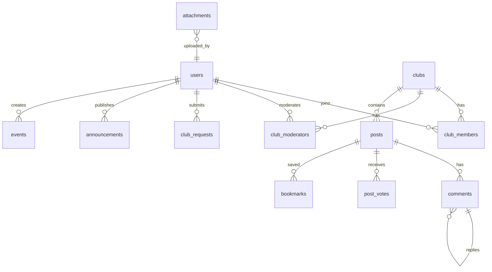

# System Architecture — Campus Connect

## Stack
| Layer | Choice | Why |
|---|---|---|
| App | Next.js 16 App Router, React 19, TypeScript strict | One deployable; server components + server actions = no separate API to explain |
| Styling | Tailwind CSS v4 with our own tokens | Fast, consistent design system |
| DB | PostgreSQL (local 16 for dev; Neon via Vercel Storage in prod) | Relational data, constraints |
| ORM | Drizzle + postgres.js | SQL-like, typed, readable migrations |
| Auth | Own: bcryptjs hashes + jose-signed JWT in httpOnly cookie | ~100 lines, fully explainable |
| Validation | Zod v4 | Shared schemas for every action |
| Files | `attachments` table (bytea, ≤ 4 MB) served by a route handler | No extra service; works on Vercel |
| Hosting | Vercel | Team account available |

`cacheComponents` is disabled: every page is per-user and rendered at request time.

## Layers
```
src/app/**            routes (server components) + "use server" action files
src/components/**     UI (presentational + small client components)
src/lib/auth/**       session (cookie/JWT), password hashing, permissions (can*)
src/lib/db/**         drizzle schema, client, seed
src/lib/queries/**    read functions (feeds, clubs, events…)
src/lib/validation.ts zod schemas
```
Every action: `requireUser()` → permission check (`lib/auth/permissions.ts`) → zod parse →
DB write → `revalidatePath`. Pages also check access; hiding buttons is only cosmetic.

## Roles
| Capability | Student | Moderator (own clubs) | Admin (Head CR / Head GR / HOD) |
|---|---|---|---|
| Join/leave clubs, request club | ✓ | ✓ | ✓ |
| Post/comment/vote/bookmark (in joined clubs) | ✓ | ✓ | ✓ (any club) |
| Delete any post/comment, pin posts | — | own clubs only | all clubs |
| Approve/reject club requests, assign moderators | — | — | ✓ |
| Announcements & events CRUD | — | — | ✓ |

Moderator is not a global role: it's a row in `club_moderators` (club-scoped).

## Data model

Key constraints: unique email, unique club slug, composite PKs on membership/moderator/vote/
bookmark tables, `post_votes.value IN (-1, 1)`, comment `parent_id` self-FK cascade, enums for
role / request status / event status, `ON DELETE CASCADE` from clubs → posts → comments.

## Env vars
| Name | Purpose |
|---|---|
| `DATABASE_URL` | Postgres connection string (Neon pooled URL in prod) |
| `SESSION_SECRET` | ≥ 32 chars, signs session JWTs |

## Deploy (9–10 PM window, skeleton earlier)
Vercel → import GitHub repo → Storage → Create Postgres (Neon) → env `DATABASE_URL` auto-added
→ add `SESSION_SECRET` → run `npm run db:push && npm run db:seed` against prod URL → deploy.
