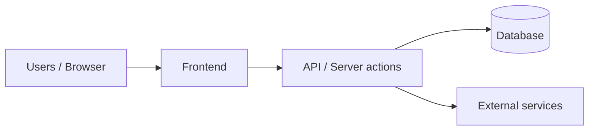

# System Architecture

## Stack
| Layer | Choice | Rationale | Rejected alternatives |
|---|---|---|---|
| Frontend | | | |
| UI kit / styling | | | |
| Backend / API | | | |
| Database / ORM | | | |
| Auth | | | |
| Storage / realtime / email / AI | | | |
| Hosting | | | |
| Testing | | | |

## Diagram

## Modules
| Module | Responsibility | Key entities | Routes / endpoints |
|---|---|---|---|

## Roles & permissions
| Permission | Role A | Role B | Role C |
|---|---|---|---|

## Folder structure

## Threat model (top 5)
| Asset | Threat | Mitigation |
|---|---|---|

## Environment variables
| Name | Purpose | Client-exposed? |
|---|---|---|

## Deployment & demo safety
- Hosting / URL:
- Seed data & demo accounts:
- Offline / local fallback:
- Backup demo video:

## Riskiest technical unknown & spike result
