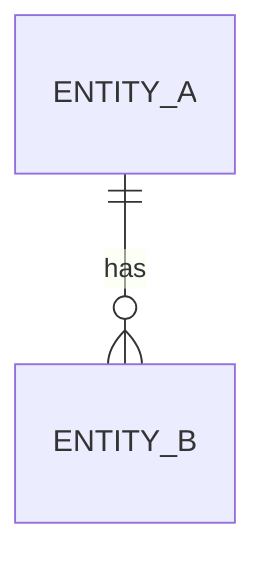

# Database Design

## Entities
| Entity | Description | Key attributes | Owner/tenant |
|---|---|---|---|

## ERD

## Tables
### `table_name`
| Column | Type | Constraints | Notes |
|---|---|---|---|
| id | uuid | PK default gen_random_uuid() | |
| created_at | timestamptz | not null default now() | |
| updated_at | timestamptz | not null default now() | |

## State machines
| Entity | States | Allowed transitions | Who can trigger |
|---|---|---|---|

## Indexes
| Table | Columns | Reason (query) |
|---|---|---|

## Integrity rules (constraints, ON DELETE behaviour, exclusion constraints)

## Row Level Security / access policies
| Table | Role | select | insert | update | delete |
|---|---|---|---|---|---|

## Seed data plan
Volumes per entity · Date spread · Demo accounts per role · Edge cases needed for the demo
